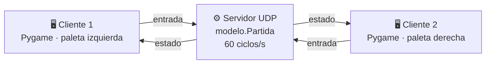
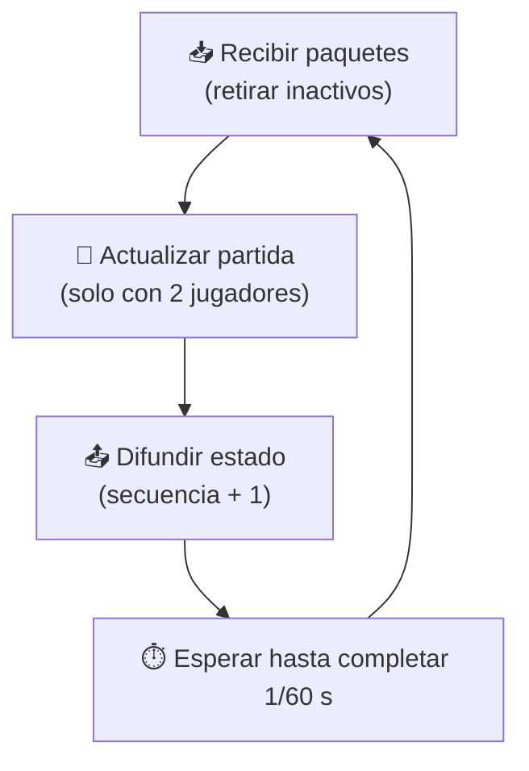

<div align="center">

# 🏓 GAME PIN PON

### Pong multijugador en red · Sockets UDP · Servidor autoritativo


**Dos jugadores. Dos computadoras. Una sola pelota.**
Un servidor autoritativo ejecuta la física a **60 Hz** y mantiene sincronizados a ambos clientes mediante datagramas UDP.

[Inicio rápido](#-inicio-rápido) ·
[Cómo funciona](#-cómo-funciona) ·
[Capturas](#-capturas) ·
[Protocolo](#-protocolo-de-red) ·
[Problemas](#-solución-de-problemas) ·
[Autores](#-autores)


</div>

---

## 📑 Contenido

- [✨ Características](#-características)
- [🚀 Inicio rápido](#-inicio-rápido)
- [🎮 Controles](#-controles)
- [🧠 Cómo funciona](#-cómo-funciona)
- [📡 Protocolo de red](#-protocolo-de-red)
- [🗂️ Estructura del proyecto](#️-estructura-del-proyecto)
- [⚙️ Opciones de línea de comandos](#️-opciones-de-línea-de-comandos)
- [📋 Logs del servidor](#-logs-del-servidor)
- [📸 Capturas](#-capturas)
- [🛠️ Solución de problemas](#️-solución-de-problemas)
- [🔭 Limitaciones y futuro](#-limitaciones-y-futuro)
- [👥 Autores](#-autores)

---

## ✨ Características

| | Característica | Detalle |
|:-:|---|---|
| 🌐 | **Multijugador en red** | Dos jugadores en computadoras distintas de la misma red |
| 🛡️ | **Servidor autoritativo** | Física, puntos y ganador se calculan solo en el servidor: sin trampas ni desincronización |
| ⚡ | **UDP de baja latencia** | Mensajes JSON ligeros a ~60 paquetes por segundo |
| 🔁 | **Tolerante a fallas de red** | Números de secuencia, reenvío continuo y contador de pausa a prueba de duplicados |
| ⏸️ | **Pausa sincronizada** | `P` pausa y reanuda la partida para ambos jugadores |
| 🧾 | **Logs en consola** | Conexiones, desconexiones e IP del servidor |
| 🕹️ | **Modo local** | Dos jugadores en un mismo teclado, sin red |
| 📦 | **Cliente de un solo archivo** | `cliente.py` se entrega al otro jugador sin dependencias del proyecto |

---

## 🚀 Inicio rápido

### 1️⃣ Instalar

```bash
git clone https://github.com/JosueVele77/game_pin_pon.git
cd game_pin_pon

python -m venv .venv
# Windows (PowerShell)
.\.venv\Scripts\Activate.ps1
# Linux / macOS
source .venv/bin/activate

python -m pip install pygame
```

> 💡 Solo los equipos que **juegan** necesitan Pygame. El servidor por sí solo no lo requiere.

### 2️⃣ Iniciar el servidor (anfitrión)

```bash
python servidor.py --jugar
```

`--jugar` abre además un cliente local: el anfitrión juega como **Jugador 1** (paleta izquierda). El servidor imprime su IPv4: esa es la dirección que usará tu rival.


### 3️⃣ Conectar al segundo jugador

En el otro equipo copia **solo `cliente.py`** y ejecuta:

```bash
python cliente.py --direccion 172.17.212.166 --puerto 12345
```

> Cambia `172.17.212.166` por la IP que mostró tu servidor. También puedes ejecutar `python cliente.py` sin argumentos y escribir la IP en el formulario.


### 4️⃣ ¡A jugar!

Cuando ambos están conectados, la partida arranca sola. **Gana quien llegue primero a 10 puntos.** 🏆

### 🕹️ ¿Sin red? Modo local

```bash
python juego.py
```

---

## 🎮 Controles

| Tecla | Acción |
|:-:|---|
| <kbd>W</kbd> / <kbd>↑</kbd> | Subir la paleta |
| <kbd>S</kbd> / <kbd>↓</kbd> | Bajar la paleta |
| <kbd>P</kbd> | Pausar / reanudar (ambos jugadores) |
| <kbd>R</kbd> | Nueva partida (cuando hay un ganador) |
| <kbd>Esc</kbd> | Desconectarse y volver al formulario |
| <kbd>Tab</kbd> · <kbd>Intro</kbd> | En el formulario: cambiar de campo · conectar |

**Modo local:** jugador izquierdo <kbd>W</kbd>/<kbd>S</kbd> · jugador derecho <kbd>↑</kbd>/<kbd>↓</kbd>

---

## 🧠 Cómo funciona

El servidor es la **única fuente de verdad**. Los clientes solo envían teclas y dibujan lo que reciben.



### 🔄 Ciclo del servidor (60 veces por segundo)



### 🛡️ Robustez frente a UDP

| Problema de UDP | Solución en Game Pin Pon |
|---|---|
| Paquetes **fuera de orden** | Cada estado lleva `secuencia`; el cliente descarta los antiguos |
| Paquetes **perdidos** | Entradas y estados se reenvían de forma continua a 60 Hz |
| Paquetes **duplicados** | `solicitud_pausa` es un contador acumulado: solo se aplica la diferencia |
| Datos **malformados** | El servidor ignora JSON inválido; el cliente valida cada campo |
| Jugador **sin respuesta** | Paleta detenida a los 0,3 s; puesto liberado a los 5 s |

### ⚽ Reglas de la física

- La pelota **acelera** en cada rebote: ×1,08 en X (máx. 950 px/s) y ×1,05 en Y (máx. ±750 px/s).
- El recorrido se divide en tramos de ~6 px para que **nunca atraviese una paleta**.
- Tras cada punto, la pelota vuelve al centro con dirección aleatoria.

---

## 📡 Protocolo de red

Mensajes JSON en UTF-8 sobre datagramas UDP · puerto por defecto **12345**.

| Tipo | Sentido | Función |
|---|---|---|
| `entrada` | Cliente ➜ Servidor | Teclas, reinicio y contador de pausa (cada cuadro) |
| `salir` | Cliente ➜ Servidor | Aviso de desconexión |
| `estado` | Servidor ➜ Cliente | Estado completo de la partida (~60/s) |
| `lleno` | Servidor ➜ Cliente | Ya hay dos jugadores registrados |

<details>
<summary><b>📨 Ver ejemplos de mensajes</b></summary>

**Cliente ➜ Servidor · `entrada`**

```json
{
  "tipo": "entrada",
  "subir": true,
  "bajar": false,
  "reiniciar": false,
  "solicitud_pausa": 3
}
```

**Servidor ➜ Cliente · `estado`**

```json
{
  "tipo": "estado",
  "secuencia": 1042,
  "numero_jugador": 0,
  "jugadores_conectados": 2,
  "posicion_pelota": [400.0, 300.0],
  "paleta_izquierda": 255.0,
  "paleta_derecha": 255.0,
  "puntos_izquierda": 1,
  "puntos_derecha": 3,
  "ganador": null,
  "en_pausa": false
}
```

</details>

---

## 🗂️ Estructura del proyecto

```
game_pin_pon/
├── 🧩 modelo.py     Reglas del juego (paletas, pelota, puntos). Sin red ni ventana.
├── 🌐 servidor.py   Servidor UDP autoritativo: jugadores, partida y difusión de estado.
├── 🖥️ cliente.py    Cliente de red + interfaz Pygame. Distribuible como archivo único.
├── 🕹️ juego.py      Modo local: dos jugadores en un mismo teclado.
└── 📚 docs/
    ├── DOCUMENTACION.md
    ├── Game_Pin_Pon_Informe_IEEE.docx
    └── capturas/
```

<div align="center">


</div>

---

## ⚙️ Opciones de línea de comandos

| Programa | Opción | Descripción | Por defecto |
|---|---|---|---|
| `servidor.py` | `--direccion` | Interfaz de escucha | `0.0.0.0` |
| `servidor.py` | `--puerto` | Puerto UDP | `12345` |
| `servidor.py` | `--jugar` | Abre un cliente local conectado al servidor | desactivado |
| `cliente.py` | `--direccion` | IP o nombre del servidor | vacío (formulario) |
| `cliente.py` | `--puerto` | Puerto UDP del servidor | `12345` |

---

## 📋 Logs del servidor

Todos los mensajes llevan el prefijo `[SERVIDOR]`:

| Mensaje | Cuándo aparece |
|---|---|
| `Escuchando en 0.0.0.0:12345 (UDP).` | Al iniciar correctamente |
| `Direcciones de esta PC: <IPv4>` | Tras iniciar; la IP que debe usar el otro jugador |
| `Jugador N: ('IP', puerto)` | Cuando un cliente se registra en el puesto N |
| `Jugador N desconectado.` | Al recibir `salir` o tras 5 s de inactividad |
| `Cerrado.` | Al detener el servidor con <kbd>Ctrl</kbd>+<kbd>C</kbd> |

---

## 📸 Capturas

<table>
  <tr>
    <td align="center" width="50%">
      <br>
      <b>Jugador 1</b> · paleta izquierda
    </td>
    <td align="center" width="50%">
      <br>
      <b>Jugador 2</b> · paleta derecha
    </td>
  </tr>
  <tr>
    <td align="center" colspan="2">
      <br>
      <b>Formulario de conexión</b> · aviso cuando el servidor no responde
    </td>
  </tr>
</table>

---

## 🛠️ Solución de problemas

<details>
<summary><b>❌ «Sin respuesta. Revisa IP, puerto, red y cortafuegos.»</b></summary>

El cliente no recibió estado del servidor en 5 s. Revisa en orden:

1. **IP correcta:** usa la IPv4 que imprime el servidor (o `ipconfig` en Windows).
2. **Misma red:** comprueba con `ping <IP-del-servidor>`.
3. **Cortafuegos:** permite el puerto **UDP 12345** de entrada en el equipo servidor. En PowerShell como administrador:
   ```powershell
   netsh advfirewall firewall add rule name="Pong UDP" dir=in action=allow protocol=UDP localport=12345
   ```
4. **Servidor activo:** debe verse `Escuchando en 0.0.0.0:12345 (UDP)`.
5. **Aislamiento de clientes:** algunas redes institucionales o de invitados bloquean la comunicación entre dispositivos.

</details>

<details>
<summary><b>🚫 «Servidor lleno: ya hay dos jugadores.»</b></summary>

El servidor admite 2 jugadores a la vez. Espera a que uno se desconecte (<kbd>Esc</kbd>) o quede inactivo 5 s.

</details>

<details>
<summary><b>📦 «Falta Pygame»</b></summary>

```bash
python -m pip install pygame
```

</details>

---

## 🔭 Limitaciones y futuro

- 👥 **Capacidad actual: 2 jugadores.** El servidor, el modelo y las validaciones del cliente están pensados para dos puestos. Ampliar a más participantes requiere modificar `modelo.py`, `servidor.py` y `cliente.py`.
- 🔒 No hay cifrado ni autenticación: úsalo en redes de confianza.
- 💡 Ideas: sala de espera con nombres, sonidos, predicción en el cliente y pruebas automatizadas.

📚 **Documentación completa:** [`docs/DOCUMENTACION.md`](docs/DOCUMENTACION.md) · [`docs/Game_Pin_Pon_Informe_IEEE.docx`](docs/Game_Pin_Pon_Informe_IEEE.docx)

---

## 👥 Autores

<div align="center">

| | Autor | Carrera |
|:-:|---|---|
| 👨‍💻 | **Josué S. Vele** · [@JosueVele77](https://github.com/JosueVele77) | Computación |
| 👨‍💻 | **Juan D. Figueroa** | Computación |

**Universidad Politécnica Salesiana** · Sede Quito – Campus Sur · Quito, Ecuador 🇪🇨

*Proyecto académico · 2026*

⭐ Si te gustó el proyecto, ¡déjale una estrella al repositorio!

</div>
